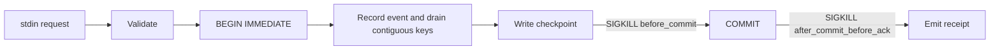

# Crash-safe event processing in Ruby and SQLite

This Ruby consumer keeps a running balance correct when events arrive out of order, arrive twice, or commit just before the sender loses its acknowledgment.

[](https://github.com/SPatel2133/ruby-event-consumer/actions/workflows/verify.yml?query=branch%3Amain)

With Ruby 3.4.13 active, reproduce the crash demo from the project root:

```sh
bundle install && bin/demo
```

The cursor is the last sequence applied to the balance. Sequence 3 can be durable while the cursor waits at 1. Each kill below starts from that same gap on a fresh database.

```text
  1, delta 5 -> {"status":"accepted","seq":1,"cursor":1,"balance":5}
  3, delta 2 -> {"status":"accepted","seq":3,"cursor":1,"balance":5}
  2, delta -1 -> {"status":"accepted","seq":2,"cursor":3,"balance":6}

Kill before_commit on a separately seeded ledger
  Signal 9, 0 stdout bytes
  SQLite before retry: {"events":[[1,5],[3,2]],"checkpoint":[1,"5"]}
  Retry 2:-1 -> {"status":"accepted","seq":2,"cursor":3,"balance":6}
Kill after_commit_before_ack on a separately seeded ledger
  Signal 9, 0 stdout bytes
  SQLite before retry: {"events":[[1,5],[2,-1],[3,2]],"checkpoint":[3,"6"]}
  Retry 2:-1 -> {"status":"duplicate","seq":2,"cursor":3,"balance":6}

Try to change event 3 to +9 -> {"error":"conflict","seq":3}
```



Run `bin/shopify-demo` for the merchant example: a CAD 100.00 sale and CAD 25.00 refund produce CAD 75.00 net after crash recovery or reconciliation. Both demos use disposable databases.

[Machine trace](evidence.jsonl) · [90-second whiteboard walkthrough](docs/interview.md) · [Benchmark](#benchmark) · [Verification](VERIFICATION.md)

## Shopify order and refund ledger

The Shopify path uses a separate SQLite database and leaves the sequence-based
consumer available through `bin/ledger`. Run `bin/shopify-check` for the
black-box Shopify suite and `bin/shopify-demo` for the replay and reconciliation
demo. Both use disposable databases and a local fake Shopify GraphQL server.
They require no Shopify account, credentials, or webhook tunnel.

```sh
bundle check
bin/check
bin/shopify-check
bin/shopify-demo
bin/shopify-ops-demo
bin/shopify-demo --evidence > shopify-evidence.jsonl
```

`bin/shopify-ops-demo` is a deterministic, self-checking walkthrough of the
operating commands. A poison delivery is parked, flagged by
`bin/shopify-status` and recovered with `bin/shopify-deliveries retry`. A
reconciliation run fails on page 2 and then resumes at page 2.
`bin/shopify-audit` traces each total to the delivery or reconciliation run
that recorded it. Finally, `bin/shopify-backup` writes a verified online
snapshot whose totals match the live ledger.

See the [Shopify verification runs](VERIFICATION.md#shopify-verification) and
[recorded demo evidence](shopify-evidence.jsonl).

Both consumers share one lockfile. CI uses the Ruby version in `.ruby-version` on Ubuntu 22.04.

### Running the Shopify commands

Set `SHOPIFY_LEDGER_CONFIG` to the path of a local JSON configuration. The
database path is resolved relative to that file. Keep the file outside version
control and use a different database from the original ledger.

```json
{
  "database": "shopify.sqlite3",
  "secret": "REPLACE_WITH_APP_CLIENT_SECRET",
  "shops": {
    "example.myshopify.com": {
      "token": "REPLACE_WITH_ADMIN_ACCESS_TOKEN"
    }
  }
}
```

```sh
export SHOPIFY_LEDGER_CONFIG=/path/to/shopify-ledger.local.json
bin/shopify-webhook
```

The service listens on IPv4 localhost at port 9292 by default. Set
`SHOPIFY_LEDGER_PORT` to change it. Register `orders/updated` and
`refunds/create` on an HTTPS endpoint that routes `POST /webhooks` to the
service and limits request body size. For order reads, use a configured shop token with `read_orders` and
Shopify's applicable data permissions. Trusted configuration selects the
destination and token. The HTTP loopback override is used by the synthetic
fixtures.

From another terminal with the same configuration:

```sh
bin/shopify-worker --once
bin/shopify-worker --drain            # until idle; add --limit N to cap outcomes
bin/shopify-worker --watch            # drain, poll every second; SIGTERM stops after the current delivery
bin/shopify-summary example.myshopify.com
bin/reconcile example.myshopify.com
```

`--once` processes one eligible delivery. It reports `processed`, `idle`,
`retry` or `parked`. A retry exits nonzero and defers the delivery for 2, 4, 8,
16, 32, then at most 60 seconds per attempt. The worker selects the oldest
eligible delivery and can process other orders while a failure backs off.
`--drain` repeats until no delivery is eligible and prints counts such as
`{"processed":12,"retry":1,"parked":0,"status":"idle"}`. It exits 1 if any
delivery was deferred or parked, or if storage failed.

Several workers can drain one database at once. Each worker claims a delivery
in a short write transaction before fetching it, so concurrent workers never
spend Admin API calls on the same order. A claim lasts for the longest
possible fetch. If the claiming process has exited, another worker takes the
claim over immediately, so a killed worker's delivery is retried at once.
Workers wait up to 5 s for the SQLite write lock. The webhook keeps a 250 ms
wait so that it can answer 503 well within Shopify's delivery timeout.

Each Admin API request is retried inside one attempt on HTTP 429, 500, 502,
503 and 504, on GraphQL `THROTTLED`, and on connection errors. Waits are 0.25 s
then doubling, and `Retry-After` is honoured up to 2 s. Set `api_attempts`
(1 to 10, default 3) in the configuration to change this. Every query is
read-only, so retrying one never changes Shopify state. Malformed or
incomplete responses are not retried; they count as a failed attempt.

### Operating the ledger

```sh
bin/shopify-status                                   # every configured shop
bin/shopify-status example.myshopify.com
bin/shopify-status --prometheus                      # metrics text for a scraper
bin/reconcile --all                                  # every configured shop, e.g. from cron
bin/shopify-backup /backups/ledger-$(date +%F).sqlite3
bin/shopify-maintain                                 # VACUUM in a quiet period; refuses while a writer is active
bin/shopify-deliveries list example.myshopify.com --state parked
bin/shopify-deliveries retry example.myshopify.com WEBHOOK_ID
bin/shopify-audit example.myshopify.com --order gid://shopify/Order/101
```

- `bin/shopify-status` reads one consistent SQLite snapshot per call. For each
  shop it reports pending, failing, parked and processed deliveries, the age
  of the oldest pending delivery, the open and last completed reconciliation
  run, the checkpoint age, which transactions came from webhooks versus
  reconciliation repair, and the totals. It exits 0 when every shop is healthy
  and 2 when a shop needs attention, so a cron job or probe can alert on it.
  `reasons` explains each problem: parked deliveries, a pending delivery
  waiting over 15 minutes, a failed reconciliation run, a checkpoint over two
  hours old, reconciliation that has never completed, or unreadable totals.
- `--prometheus` prints the same counts and ages in Prometheus text format: health, deliveries by state, oldest pending age, checkpoint age, open runs and transactions by source. The exit status is the same as for JSON. Money totals are left out on purpose: metric samples are floats, and totals must stay exact.
- `bin/reconcile --all` reconciles each configured shop in turn and prints one result per shop. A shop that fails is reported, does not stop the others, and makes the command exit 1. Its run stays resumable.
- `bin/shopify-backup DEST` copies the live database with SQLite's online backup API while webhooks and workers keep writing. The copy is one committed snapshot, so every processed delivery has its payments. It passes `PRAGMA integrity_check` and the current schema check before it is renamed into place. The command refuses to overwrite an existing file and never leaves a partial copy. It prints the copy's delivery, transaction and per-shop totals so they can be compared with the live database.
- `bin/shopify-maintain` checks the schema and runs VACUUM in SQLite exclusive locking mode, so no webhook or worker writes between the check and the rebuild. It compares per-shop totals before and after the VACUUM. If any writer holds the database, it exits 1 with "busy" instead of waiting, and webhooks then get retryable 503s. Run it while nothing is writing.
- After `max_attempts` failed attempts (1 to 1000, default 12) a delivery is
  **parked**. The worker never selects it again, so a poison order cannot use
  up worker time, and other orders keep flowing. `bin/shopify-deliveries list`
  shows deliveries by state with attempt counts, the last error and
  timestamps. `retry` gives one parked or failing delivery a fresh attempt
  budget and records the requeue. It refuses a processed delivery because its
  effects are final, and it refuses an unknown delivery ID.
- `bin/shopify-audit` explains a total. Each stored transaction lists the
  delivery (`recorded_by: delivery`, `reference: WEBHOOK_ID`) or reconciliation
  run (`reconciliation`, run ID) that first recorded it, plus the time it was
  recorded. `--order` adds that order's totals and every webhook delivery that
  referenced it. Rows written before provenance tracking report `unknown`.
- The worker, reconciliation and Admin retries write one JSON object per line
  on stderr, for example `{"event":"delivery_parked","shop":...,"delivery":...,"attempt":12,"error":...}`.
  Logs carry identifiers and outcomes only, never tokens or webhook bodies.

### Storage and recovery

- Verify the Shopify signature over the raw body before JSON parsing. Store only shop, delivery ID, topic, and order ID plus processing metadata. Return HTTP 200 after committing a new delivery or confirming a matching retry. Reusing the same shop and delivery ID for a different order or topic returns HTTP 409. The first delivery remains available to the worker.
- The worker fetches a complete order transaction set through Admin GraphQL `2026-10` outside the SQLite write transaction. It requires an exact transaction count and distinct IDs. It counts successful sales and captures as collected, and successful refunds as positive refunds. Net is collected minus refunded. Totals are exact decimal strings separated by shop and shop currency. They describe observed order payment transactions.
- Worker writes and the inbox processed flag commit together. A delivery ID deduplicates HTTP retries, and a transaction ID deduplicates payment effects across different deliveries. Shopify webhook delivery order is irrelevant because each accepted delivery points to the current order transactions.
- Reconciliation reads a fixed window of changed orders using `UPDATED_AT`. It saves the start of the first seven-day window before fetching page one. A retry keeps that starting point even if the first scan failed days ago. After a successful run, later scans start five minutes before the completed checkpoint. Failed scans can leave imported orders durable while preserving the checkpoint for replay. Recovery covers the chosen window and the shop's authorized order history.
- Each window is a durable `reconciliation_runs` row. After every fully applied page, the run stores the next page cursor. A failed or killed run resumes at the first page it had not applied, then a fresh window runs up to now. Resuming is safe because the window's upper bound is fixed. An order updated after the failure leaves this window and falls inside the next one, which starts five minutes before this window's end. If a saved cursor fails on its first reuse (for example, because it expired), the next attempt rescans the window from page one. Repeated pages are idempotent because payments are identified by transaction ID. Only one unfinished run per shop can exist.
- The schema is versioned. Each command compares the database's table definitions with every known version and applies only the later migrations, all in one SQLite transaction. SQLite DDL is transactional, so a failed upgrade leaves the previous version intact and a later command can retry it. Commands verify the application tables before reporting merchant totals. An unrecognized database produces an error and is not modified.
- The demo proves recovery from process death on one host. Verification uses synthetic Shopify responses and a single SQLite database. A live Shopify installation, power loss, and multi-host operation are outside the verified scope.

[Shopify webhook verification](https://shopify.dev/docs/apps/build/webhooks/verify-deliveries) ·
[Order transaction schema](https://shopify.dev/docs/api/admin-graphql/2026-10/objects/OrderTransaction) ·
[Order reconciliation query](https://shopify.dev/docs/api/admin-graphql/2026-10/queries/orders)

## Warehouse inventory walkthrough

From the project root, install the locked dependencies if needed. Run the inventory demo to exercise crash recovery.

```sh
bundle check || bundle install
project="$PWD"
"$project/bin/inventory-demo"
```

The warehouse opens with 20 units. Its ledger balance tracks *adjustments*. Watch scan 3 wait behind a gap, then watch SQLite after the child dies while acknowledging scan 2. The retry should leave 25 units on hand.

Output from `bin/inventory-demo` on Ruby 3.4.13

```text
Opening stock is 20 units. The ledger records adjustments starting at zero.
Scan 1 (+10) accepted. Cursor 1, adjustment +10, 30 units on hand.
Scan 3 (-2) accepted. Cursor 1, adjustment +10, 30 units on hand.
Waiting for scan 2. Scan 3 is already stored.
Scan 2 (-3) committed. SIGKILL (9) before acknowledgment, 0 stdout bytes.
SQLite before retry: rows=[[1,10],[2,-3],[3,-2]] checkpoint=[3,"5"]
Retry scan 2: {"status":"duplicate","seq":2,"cursor":3,"balance":5}
20 opening units + 5 adjustment units = 25 units on hand.
```

To inspect a stalled stream yourself, run the following from that same shell. The two deliveries create a ledger in a new temporary directory.

```sh
(
  cd "$(mktemp -d)" || exit 1
  printf '%s\n' '{"op":"deliver","seq":1,"delta":10}' | "$project/bin/ledger"
  printf '%s\n' '{"op":"deliver","seq":3,"delta":-2}' | "$project/bin/ledger"
  "$project/bin/doctor"
)
```

The doctor reads the caller's ledger in one SQLite snapshot. Here the applied balance is +10, and scan 3 is already stored. Receiving scan 2 will allow both adjustments to apply.

Doctor supports the original ledger's rollback journal. It reports a missing ledger without creating a file and refuses externally configured WAL mode before SQLite can create sidecars.

## Benchmark

`ruby benchmark/shopify_drain.rb` drains 200 deliveries against a fake Admin API that answers in 50 ms. One worker processed 17.9 deliveries/s and eight processed 122.8/s, with exactly one fetch per delivery ([results](VERIFICATION.md#concurrent-workers)).

`ruby benchmark/shopify_ingest.rb` measures webhook acknowledgments under concurrent senders and drain workers ([results](VERIFICATION.md#webhook-ingest-under-contention)).

`ruby benchmark/shopify_operations.rb` times Shopify worker selection and `bin/shopify-status` against 50,000 parked and 50,000 processed deliveries ([results](VERIFICATION.md#measured-boundary-parked-history)).

Run `bin/benchmark --full` for the 100,000-event workload, or `bin/benchmark --smoke` to check the same paths quickly. This single-writer sample used an Apple M5 with 16 GiB, Ruby 3.4.13 and SQLite 3.54.1.

| Measured boundary | Samples | Throughput | p50 / p95 |
| --- | ---: | ---: | ---: |
| Ordered inserts, in-process | 100,000 | 3,716/s | 0.251 / 0.346 ms |
| Identical retries, in-process | 100,000 | 15,978/s | 0.059 / 0.067 ms |
| Ordered inserts, fresh CLI process per event | 20 | 14.35/s | 69.363 / 71.533 ms |

Each in-process call opens SQLite, takes a write reservation, commits one request and closes the database. CLI timing also includes spawning Ruby, loading Bundler, parsing and emitting JSON, and waiting for exit. With 10,000 events already buffered, one in-process gap-closing delivery took **22.549 ms**. Setup and state verification run outside the timer.

The initialized database grew from 12,288 to 901,120 bytes, or **888,832 bytes for 100,000 unique events** (8.89 bytes/event with these integer keys and +1 payloads). Replaying all 100,000 left the row count at 100,000. Rollback journal mode was DELETE, synchronous was FULL (2), and pages were 4,096 bytes. All measured sidecars were absent after close. No WAL checkpoint ran. [Full machine-readable sample](benchmark/results.json)

## Optional storage maintenance

Run `bin/maintain /path/to/ledger.sqlite3` during a quiet period. It validates the existing schema under an exclusive lock and runs SQLite VACUUM. A missing path or busy writer yields a diagnostic and a nonzero exit. Ordinary delivery never runs maintenance.

With 257 free pages, the test database shrank from 1,064,960 to 12,288 bytes. A fully live 12,288-byte fixture stayed the same size. All event identities survive, including pending rows. Deleting applied rows would let a conflicting historical retry be accepted with a different delta. Inspect the scratch reproduction with `bin/check -n /MaintenanceTest/`. [Maintenance tests](test/maintenance_test.rb)

## Setup and original demo

Tested on macOS arm64 with Ruby 3.4.13, Bundler 4.1.0, sqlite3 gem 2.10.2, and Minitest 5.27.0.

Linux CI is configured for Ubuntu 22.04. To try the sequence CLI as an installed RubyGem, see the [local gem installation](VERIFICATION.md#reproduce-the-isolated-gem-install).

Run these commands from the project directory. `bin/setup` checks the Ruby
version in `.ruby-version`, installs the locked gems, and runs
`bin/shopify-ops-demo` against a scratch directory. It is safe to rerun.

```sh
bin/setup
bin/check
bin/demo
bin/demo --evidence > evidence.jsonl
```

The demo creates and removes its own scratch databases. It shows the sequence order 1, 3, 2, two real process kills, the SQLite rows before each retry, and a rejected conflict. The checked-in [evidence](evidence.jsonl) records expected and observed results, versions, and a digest of the source, test, and dependency files. See [verification](VERIFICATION.md) for the release commands and results.

Try the production entry from an unrelated directory.

```sh
project="$PWD"
scratch="$(mktemp -d)"
(
  cd "$scratch" || exit 1
  printf '%s\n' '{"op":"deliver","seq":3,"delta":2}' | "$project/bin/ledger"
  printf '%s\n' '{"op":"state"}' | "$project/bin/ledger"
)
```

The first response is `{"status":"accepted","seq":3,"cursor":0,"balance":0}`. The state stays at cursor 0 and balance 0 until the missing earlier sequences arrive.

## How it works

- Ruby validates the request before opening storage. It recognizes an identical retry by sequence and delta and returns the current checkpoint. A different delta for a stored sequence is a conflict, even after that event has been applied.
- SQLite stores the first accepted delta for each sequence and one checkpoint. Ruby finds the consecutive keys above the cursor and sums their deltas. A zero delta still advances the cursor. Insertion and checkpoint update commit together under `BEGIN IMMEDIATE`.
- Ruby emits the receipt after SQLite commits. If the process dies between the commit and the receipt, retrying the same event returns `duplicate`. A death before commit allows the retry to return `accepted`. Splitting the insert and checkpoint updates into two commits can strand an event row with a stale checkpoint after a crash.
- A SQLite lock timeout returns `{"error":"busy","retryable":true}` after rolling back any active transaction. The lock wait is configured for 250 ms. Unexpected failures exit nonzero with a diagnostic on stderr.
- Sequences are positive signed 64-bit integers, and each delta is signed 64-bit. Ruby sums with arbitrary precision. SQLite stores the balance as canonical decimal text. The JSON response contains exact integer tokens. JavaScript clients using `Number` can lose precision for values outside the safe-integer range. Use a lossless JSON parser for such values.

An indefinitely missing sequence stalls the checkpoint and lets pending rows accumulate. Applied rows are retained too, so the database grows with the number of unique sequences. That history lets the ledger distinguish identical retries from conflicting deltas after application.

The recovery tests verify process death on one host with one local SQLite database and no external side effects. Power loss and exactly-once delivery across services are outside the tested scope.

## Walkthrough questions

1. What stored fact proves event 3 was received but remains unapplied?
2. Why do the two retries yield different receipts with the same final balance?
3. What changes if the missing sequence never arrives?
