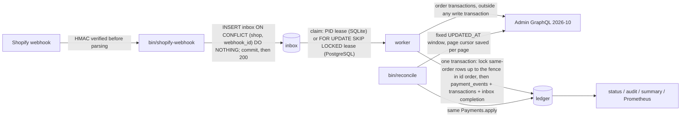

# Shopify ledger architecture

## Data flow

A route in the config picks each shop's database (`database_for(shop)`).
`bin/shopify-move-shop` moves a shop in three steps: copy and verify, switch the
route, then clean up.

## Tables

| Table | Key | Written by | Notes |
| --- | --- | --- | --- |
| `inbox` | `(shop, webhook_id)` | webhook, worker | Holds the delivery's state: attempts, backoff, parked, claim. |
| `payment_events` | `(shop, transaction_id)` | worker, reconciliation | Every Shopify transaction with its latest status. Statuses move from open to final only. |
| `transactions` | `(shop, transaction_id)` | worker, reconciliation | Insert-only. Holds only `SUCCESS` sales, captures and refunds, as exact decimal strings. |
| `checkpoints`, `reconciliation_runs`, `reconciliation_starts` | `shop` / run ID | reconciliation | The checkpoint never moves backwards. A failed run resumes from its saved cursor. |

## Invariants and where they are checked

| Invariant | Example tests | Randomized |
| --- | --- | --- |
| No `(shop, transaction_id)` is stored twice | `ledger_test`, `webhook_identity_test` | fuzzer, after every step |
| Every stored transaction equals Shopify's ground truth | `payment_domain_test`, `isolation_regression_test` | fuzzer, after every step |
| After settle, the stored set and totals equal the model exactly | `operations_edge_test` | fuzzer settle phase |
| No delivery is both processed and parked; no claim points at a live non-worker | `drain_test`, `operations_race_test` | fuzzer, after every step |
| Reconciliation checkpoints never move backwards | `resumable_reconciliation_test`, `ledger_test`, `operations_race_test` | fuzzer, after every step |
| A stored status never contradicts Shopify's | `payment_domain_test` | fuzzer, after every step |
| A moved shop leaves no rows outside its routed database | `shop_routing_test` | fuzzer settle phase (`move_shop`) |

The fuzzer runs the same operation lists against SQLite (`bin/shopify-fuzz`)
and PostgreSQL (`--postgres`). `--processes` adds real concurrent workers and
workers SIGKILLed mid-fetch. Measured campaigns are listed in
[VERIFICATION.md](../VERIFICATION.md).

## Crash seams

| Seam | What survives | Recovery |
| --- | --- | --- |
| Webhook killed after commit, before the `200` | The delivery | Shopify redelivers it; the duplicate is ignored |
| Worker killed mid-fetch | The delivery and a claim from a dead PID or an expiring lease | Another worker takes it over |
| Worker killed before commit | Nothing from the attempt | The fetch is retried |
| Worker killed after commit | Payments and completion | Nothing to redo |
| Reconciliation fails on page N | Pages before N and the cursor | The next run resumes at N |
| Move killed after copy or after switch | One complete routed copy | Rerunning the command finishes the move |
